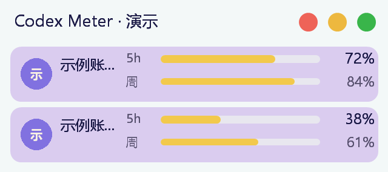
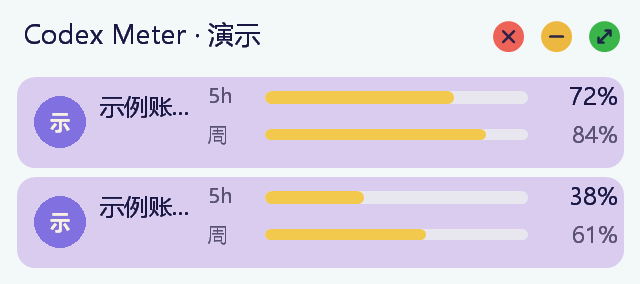
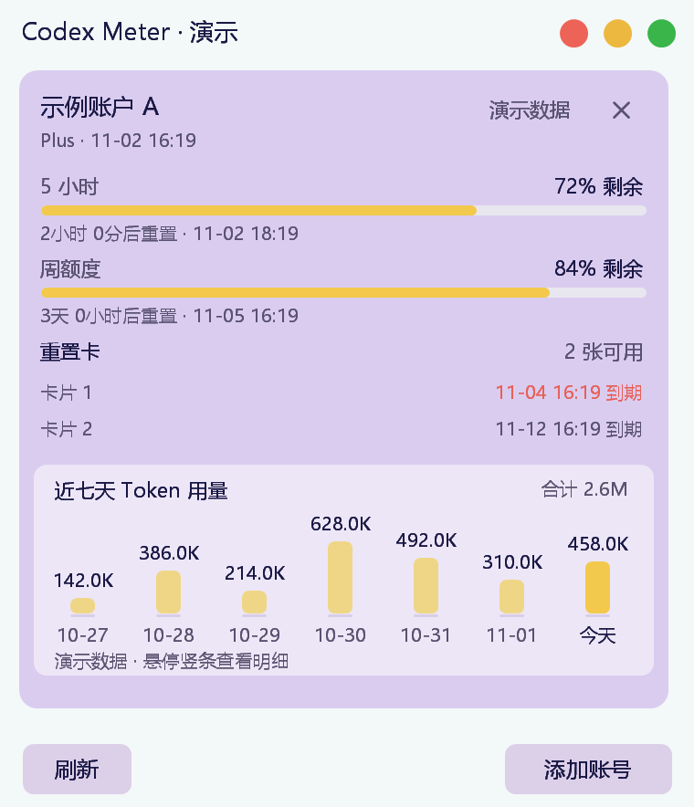
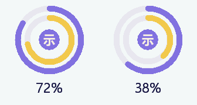
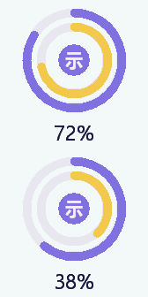

# Codex Meter

<p align="center"></p>

Windows 原生 Codex 额度悬浮窗。淡紫、米黄色主题，支持多个账号、周额度、重置时间、重置卡明细和七天 Token 用量。当前版本 **0.3.6**，本项目为独立社区工具，与 OpenAI 无隶属关系。

[下载 Windows x64 版](https://github.com/leiting-77/codex-meter/releases/latest) · [更新记录](CHANGELOG.md) · [使用与验证范围](TESTING.md)

## 功能演示

以下图片复用当前版本的界面绘制代码，以 200% 分辨率直接导出无损 PNG；使用实色背景便于阅读，未包含系统合成的磨砂材质和窗口阴影。账号、额度、用量和重置卡均为演示数据，不包含真实账号信息。

### 紧凑悬浮窗

日常只保留账号显示名称、短周期和周额度进度条；右上角红、黄、绿按钮控制关闭、收起和展开。

<p><a href="docs/images/compact.png"></a></p>

文字采用适配透明背景的灰度抗锯齿合成，辅助文字提高对比度；红绿灯在悬停时显示圆头矢量符号。

<p><a href="docs/images/compact-controls.png"></a></p>

### 额度详情

展开后查看每个周期的剩余额度、重置倒计时，以及服务返回的重置卡数量和到期时间。账号卡右上角的 × 用于移除账号。

重置卡剩余有效期不足 72 小时时，到期日期显示红色；已过期的卡标为红色“已到期”。到期时间未提供时保持普通提示。

<p><a href="docs/images/account-preview.png"></a></p>

### 近七天 Token 用量

每个账号详情底部显示含今天在内的七天竖条，米黄色柱形、今日强调、合计和悬停完整数值。日期使用服务返回的日桶标签，展示最近七个本地日历日期；服务文档未说明日桶时区，不能据此推断本地午夜精确归属。缺失日期显示“—”，真实零值显示 0；七天不全时标为“已知合计”。

通过官方 `account/usage/read` 读取账号 Token 活动，不从额度百分比换算，也不扫描聊天记录。该统计的具体覆盖范围以服务返回为准，不承诺与周额度消耗对应。旧版 Codex 或账号未提供日桶时显示提示，额度查询继续工作。详情可见时最多每五分钟查询一次，F5 或右键刷新可立即查询；收起、贴边或隐藏时暂停额外用量查询，已在途任务可完成。

每个账号最多缓存 30 个日期，重启先显示缓存并注明更新时间；成功查询后以服务快照替换，失败保留旧数据。跨日自动移动七天窗口，换账号或移除账号时清理对应缓存。

### 屏幕边缘收纳

拖至屏幕边缘后收纳成圆环条，下图展示贴顶横向形态；贴左右边缘时纵向排列。内圈米黄表示短周期额度，外圈淡紫表示周额度；只有周额度时显示单圈。中心是默认文字头像，单击恢复窗口，拖动可沿当前边缘移动。

<p><a href="docs/images/edge-dock.png"></a> &nbsp; <a href="docs/images/edge-dock-vertical.png"></a></p>

点击图片可查看两倍分辨率原图。导出方式见 [演示图片说明](docs/images/README.md)。

## 直接运行

解压发行包，双击 `codex_meter.exe`。首次启动没有示例账号。

- 已在这台电脑登录 Codex：右键窗口 → **关联本机 Codex 登录**。
- 添加独立账号：展开窗口 → **添加账号**，在官方浏览器页面完成登录。
- 多账号：重复添加。右键对应账号可重新登录、刷新、退出并移除。
- 未找到 Codex：安装官方 Codex CLI，右键 → **设置 → 选择 Codex 程序…**。自动查找 PATH、旧安装目录及新版桌面应用的版本子目录。需要支持 app-server 的 Windows 原生可执行文件；不接受 npm 的 .cmd 启动脚本。
- 官方 CLI 安装说明：[Codex CLI](https://learn.chatgpt.com/docs/cli)。

本版本复用官方 Codex app-server 的浏览器登录及令牌管理，**没有实现另一套独立的 Sign in with ChatGPT 客户端**。后者能否读取相同额度字段仍需单独验证。普通用户无需填写密码到本应用，也无需 API Key。

## 窗口操作

- 顶栏采用暖白、淡紫和深靛蓝配色；支持的 Windows 11 系统使用 DWM Acrylic 背景材质，文字和卡片保持清晰。不支持的系统及高对比度模式回退实色背景，不再整体降低窗口透明度。右上角红点默认退出，可在设置中改为隐藏到托盘；黄点收起、绿点展开。
- 拖动顶栏时触及屏幕工作区边缘即可收纳为圆环窄条；按住圆环区域拖动可沿当前屏幕边缘移动，单击恢复之前的窗口模式和位置。拖动后松手不会展开。位置自动保存，多账号收纳条限制在屏幕内，支持滚轮浏览。
- 收纳圆环中心使用昵称生成的默认文字头像；当前不下载远程真实头像。有短周期和周额度时，内圈米黄、外圈淡紫，只有周额度时显示单圈。低额度显示提醒标记，保留两圈不同颜色。悬停显示完整昵称、各周期数值与重置时间。
- 收起：账号名称、当前额度进度条、周额度（服务返回时）。
- 展开：全部额度窗口、重置倒计时与本机时区时间、重置卡数量及已返回的到期明细；每张账号卡右上角的 × 可删除账号。
- 滚轮：账号较多时滚动。支持 Page Up / Page Down。
- F5 刷新，Esc 收起，Ctrl+N 添加。
- 托盘单击显示/隐藏；右键 → 设置集中管理置顶、磨砂、任务栏显示、红色关闭按钮行为、启动模式和刷新间隔。
- 保存窗口及收纳前的位置；默认启动收起，可设置为启动展开。
- 演示模式必须显式运行 `codex_meter.exe --demo`，顶栏注明“演示”，不会混用真实账号。
- `--live` 自动关联本机 Codex；`--expanded` 启动即展开。
- `--data-dir "D:\自定义目录"` 指定应用数据目录。
- `--windowed` 在任务栏显示窗口，方便桌面调试；默认仍为悬浮工具窗。

## 数据与内存

默认每 60 秒刷新，可改为 30 秒或 5 分钟。普通查询串行执行，浏览器登录使用独立队列，登录等待不会阻塞其他账号刷新；最多同时两个应用启动的 Codex 子进程。登录完成后关闭登录会话，在新会话中读取身份与额度，最多三次可取消重试。任务完成后关闭对应进程树。

“停止当前登录／同步”只作用于正在执行的任务，无任务时置灰。主动停止后，该账号在本次运行期间暂停自动刷新，不按网络错误处理；手动刷新、重新登录或重启应用后继续。其他账号不受影响。测量内存时应同时统计主程序和查询／登录子进程。

**已知性能限制：** 本机 0.3.0 抽样中主程序工作集约 18 MiB，但官方 Codex 查询子进程曾达到约 1 GiB，完成后释放。小体积 EXE 不代表查询期间总占用低；本次发布尚未消除此限制。详见 [TESTING.md](TESTING.md)。

- 剩余 = 100 − 已用，分别显示不同窗口，不按总 Token 估算。
- 仅周期为 10080 分钟的窗口标记为周额度；不把任意长周期当成周。
- 未知值显示“— / 未提供”，不当成 0 或无限。
- 更新失败保留本次运行中最后成功的快照，并标记旧数据；带退避重试。
- 到达重置时间等待重新查询，绝不直接补成 100%。
- 重置卡数量取 availableCount，明细可能不完整，到期时间可能未提供。
- 不自动使用重置卡，不发送模型推理请求。

紧凑窗口只显示独立的显示名称，不显示邮箱或截取邮箱前缀。优先使用本地昵称，其次使用接口返回的 name/displayName；没有昵称时显示“账号 1、账号 2”。右键账号 → **设置显示名称…** 可填写自己的昵称，刷新和重启不会覆盖；留空恢复自动名称。当前账号接口不保证返回 ChatGPT 网页中的昵称。完整邮箱仅保留在详情与账号菜单中用于识别。

## 数据目录与登录

默认：`%LOCALAPPDATA%\CodexMeter`

- settings.json：窗口设置和账号元数据，不含 Token。
- profiles/<随机ID>/：各账号独立的 CODEX_HOME。
- usage-cache/<账号ID>.json：最近每日 Token 数、账号识别元数据及更新时间，不含聊天内容或凭据。
- 新增独立账号强制使用 Codex 的 keyring 凭据存储；系统凭据库不可用时会报错，不回退为明文。
- 本机 Codex 账号使用现有配置，不复制凭据，不退出原账号。
- 移除独立账号先通过 account/logout 清除该登录；若服务失败则保留账号，显示失败供重试。
- 本应用不解析、导出或记录 Token，详见 [PRIVACY.md](PRIVACY.md)。

## 构建与测试

Windows 10/11，C++17。依赖 nlohmann/json 3.12.0 已固定并随源码提供；不需要 Node、Python、Rust 或浏览器引擎运行本应用。

MinGW：

```powershell
powershell -NoProfile -ExecutionPolicy Bypass -File scripts/build.ps1
```

输出根目录及 dist/codex_meter.exe，并运行离线解析、IPC 和配置测试。

运行 scripts/package.ps1 生成包含说明和许可证的 ZIP，以及 SHA256 校验文件。不要把本地账号数据加入发行包。

MSVC / CMake：

```powershell
cmake -S . -B build -A x64
cmake --build build --config Release
ctest --test-dir build -C Release --output-on-failure
```

Windows CI 工作流位于 .github/workflows/windows.yml。本地已验证 MinGW 和 MSVC/CMake/CTest；v0.3.1 的 GitHub Actions 构建、离线测试及打包已通过。

## 当前边界

本机真实账号只读额度查询已验证；独立账号浏览器登录、多个真实账号凭据隔离、重登与不同套餐的重置卡差异需要用户测试。提供了相应实现与离线测试，不能把模拟测试视为真实授权验证。

当前发行包不包含 Codex CLI、不自动下载它；不包含安装器、代码签名、开机自启、跨平台支持或云同步。源码采用 MIT；第三方库保留原许可证。完整测试步骤见 [TESTING.md](TESTING.md)。

